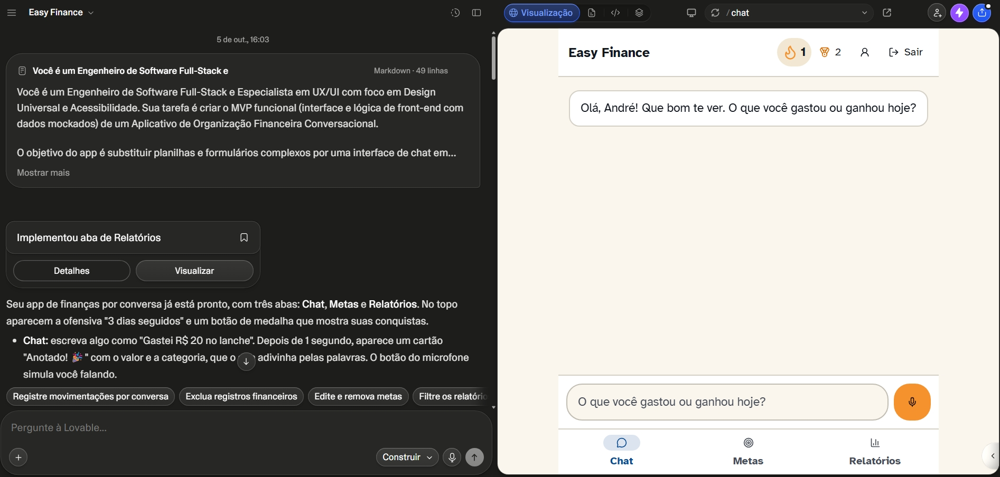
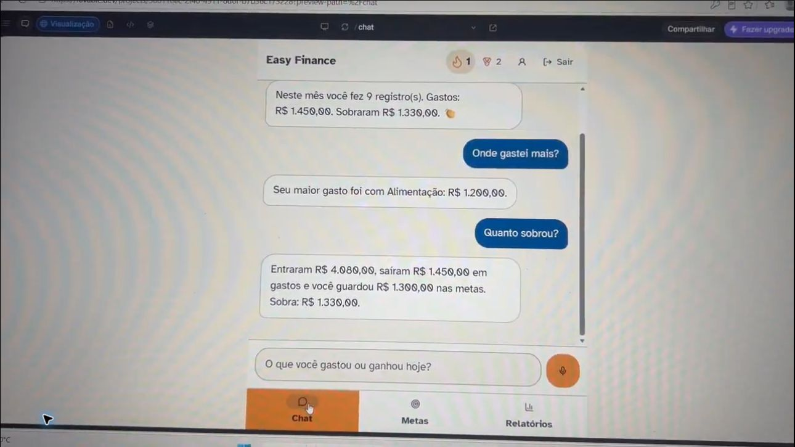
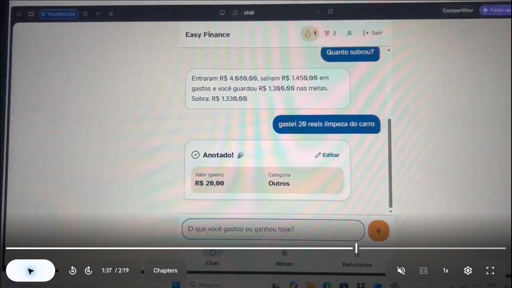
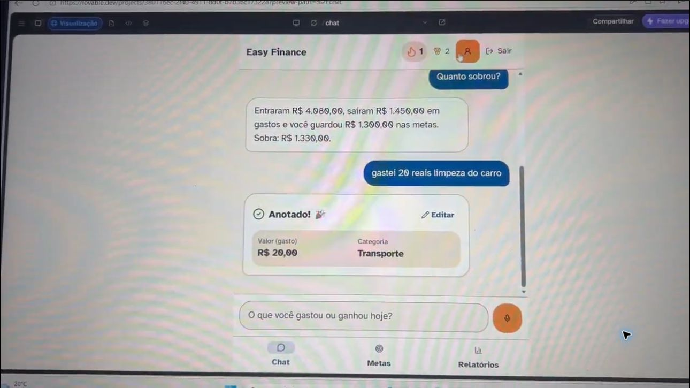

# 💸 Easy Finance — Organização financeira conversacional

> **Projeto de Vibe Coding | Desafio DIO**  
> **Status:** MVP desenvolvido no Lovable, evidências visuais selecionadas e validação manual parcialmente concluída.

O **Easy Finance** é um aplicativo de organização de finanças pessoais que permite registrar receitas, despesas e valores guardados em metas por meio de frases simples, como **“Gastei R$ 30 no mercado”**. O objetivo é reduzir a burocracia do controle financeiro e incentivar hábitos consistentes por meio de uma interface acessível, relatórios claros e reforços positivos.

🔗 **[Abrir demonstração do aplicativo](https://easyfinancebr.lovable.app/)**  
🛠️ **Ferramenta de desenvolvimento:** Lovable, orientado por prompts em linguagem natural.

## 🎯 O desafio e o problema

Muitas pessoas abandonam o planejamento financeiro porque precisam preencher formulários longos, compreender termos técnicos ou manter planilhas complexas. A proposta do Easy Finance é tornar o primeiro passo tão simples quanto escrever uma mensagem.

Este projeto foi desenvolvido no contexto do desafio **“App de Organização de Finanças Pessoais com Vibe Coding”**, da DIO. O foco do desafio é exercitar a comunicação com a IA para transformar uma ideia em um conceito de produto e um MVP.

## 👥 Público-alvo e princípios

- Pessoas iniciantes na organização financeira.
- Pessoas que preferem uma interação conversacional, em vez de formulários complexos.
- Usuários com diferentes necessidades de acessibilidade.

**Princípios de produto:** linguagem simples, design mobile-first, alto contraste, alvos de toque amplos, ícones acompanhados de texto, baixo esforço cognitivo e incentivo positivo — sem mensagens de culpa por gastos.

## 🧠 PRD final — Product Requirements Document

### Contexto

Criar um aplicativo de finanças pessoais em português brasileiro que ajude o usuário a registrar movimentações e acompanhar sua situação financeira por meio de uma experiência parecida com um chat.

### Problema a resolver

O registro manual frequente é cansativo, e muitos aplicativos exigem conhecimentos financeiros ou disciplina inicial que o usuário ainda está tentando desenvolver.

### Objetivo do MVP

Permitir que uma pessoa autenticada registre seus gastos e ganhos usando frases curtas, visualize as informações categorizadas, crie metas financeiras e acompanhe o progresso e os resultados do mês.

### Funcionalidades essenciais

1. **Registro conversacional:** interpretar frases como “Gastei R$ 25,50 no iFood” ou “Recebi 2 mil de salário”, identificando valor, tipo e categoria.
2. **Categorização automática:** classificar receitas e despesas em categorias como Alimentação, Transporte, Moradia, Saúde, Lazer e Renda, com possibilidade de corrigir valor ou categoria.
3. **Metas financeiras:** criar uma meta por conversa guiada, registrar valores guardados e exibir quanto já foi acumulado e quanto falta.
4. **Assistente financeiro amigável:** confirmar operações, responder a perguntas simples sobre os números do mês e incentivar o hábito de registro com linguagem acessível.
5. **Relatórios visuais simples:** apresentar entradas, gastos, valores destinados às metas, sobra do mês e categorias com maiores despesas.

### Navegação e experiência

- Tela pública de cadastro e login.
- Área autenticada com três abas principais: **Chat**, **Metas** e **Relatórios**.
- Cabeçalho com marca Easy Finance, ofensiva de dias seguidos, conquistas, perfil e saída.
- Preferências de acessibilidade, incluindo texto ampliado, alto contraste e redução de animações.

### Comportamento esperado do Agente Financeiro — conceito de evolução

O agente deverá usar tom acolhedor, objetivo, educativo e não punitivo. Em uma versão futura, poderá analisar padrões de gastos **com consentimento do usuário**, sugerir metas realistas e criar planos de economia personalizados, explicando o motivo de cada sugestão. As recomendações deverão respeitar a privacidade e não se apresentar como aconselhamento profissional individualizado.

**Limite importante:** na versão atual, o chat utiliza regras de interpretação e respostas predefinidas. **Não há modelo de IA generativa conectado nem planos personalizados de economia implementados.** O comportamento acima descreve o direcionamento futuro do produto, não uma funcionalidade entregue.

### Critérios de validação do MVP

- Registro de despesa com valor e categoria corretos.
- Registro de receita e edição com reflexo nos relatórios.
- Criação de meta e depósito com atualização de progresso.
- Apresentação correta de entradas, gastos e sobra do mês.
- Persistência dos registros financeiros após recarregar e proteção dos dados por usuário.

## 📱 O que foi desenvolvido

| Recurso | Situação (auditoria e testes do autor) |
|---|---|
| Cadastro, login, recuperação de senha e área protegida | Cadastro, login e recuperação de senha testados e aprovados pelo autor; tentativa de acesso direto sem sessão não confirmada separadamente |
| Registro de receitas e despesas por texto | Testado e aprovado pelo autor; interpretação feita por regras locais |
| Categorização e edição de lançamentos | Testadas e aprovadas pelo autor |
| Criação e acompanhamento de metas | Testados e aprovados pelo autor, inclusive persistência das metas após recarregar a página |
| Relatórios do mês atual | Implementado |
| Ofensiva, conquistas e opções de acessibilidade | Implementado |
| Botão de microfone | Simulação com frase fixa |
| Histórico de mensagens após recarregar | Parcial; mensagens não persistem |
| Agente com IA generativa e dicas personalizadas | Não implementado |

As três abas são componentes internos da área autenticada. Os dados de transações e metas são persistidos no banco e compartilhados pelas telas; as mensagens exibidas no chat ficam em memória.

## 🛠️ Tecnologias identificadas

- **Frontend:** React 19, TanStack Start, TypeScript, Vite e Tailwind CSS v4.
- **Interface:** componentes shadcn/ui e ícones Lucide.
- **Backend e autenticação:** Lovable Cloud, com banco PostgreSQL e sessão por e-mail/senha.
- **Validação e integridade:** validação de entradas com Zod e controles de acesso aos registros do próprio usuário.
- **Interpretação de frases:** regras locais de reconhecimento de valores e palavras-chave, sem serviço externo de IA.

## 🔄 Evolução por prompts: Vibe Coding na prática

### Iteração 1 — Definição do protótipo

O prompt inicial orientou o Lovable a criar um **MVP mobile-first com dados simulados**, três abas, registro em formato de conversa, metas, relatórios, gamificação e princípios explícitos de Design Universal. Também especificou o microfone e as respostas simuladas.

**Aprendizado:** critérios claros de público, experiência, acessibilidade e comportamento da interface ajudam a IA a produzir algo mais alinhado à intenção do criador.

### Iteração 2 — Identidade e autenticação

Um segundo prompt definiu o nome **Easy Finance** e solicitou cadastro, login, recuperação de senha, bloqueio de telas sem autenticação e logout, mantendo os critérios de acessibilidade.

**Aprendizado:** uma funcionalidade nova precisa se integrar à navegação e à experiência já existente.

### Iteração 3 — Integração das telas e persistência

Ao perceber que as abas estavam desconectadas — metas não persistiam, registros para metas eram classificados incorretamente, a edição não funcionava e relatórios não atualizavam — foi enviado um prompt de correção com a ideia de **Single Source of Truth**.

Ele especificou estruturas para transações e metas, dados vinculados ao usuário, eliminação dos exemplos estáticos, atualização reativa das três abas e funcionamento do botão Editar.

**Aprendizado:** apontar sintomas concretos, fornecer exemplos de entrada e descrever resultados esperados ajuda a IA a corrigir integrações em vez de apenas alterar a aparência.

## 📸 Evidências das interações com a IA

### Evidência 1 — Do prompt inicial ao aplicativo

Nesta captura, o prompt inicial aparece à esquerda, a resposta de implementação do Lovable logo abaixo e a interface do Easy Finance à direita. A imagem documenta a passagem da instrução em linguagem natural para um protótipo navegável.

### Evidência 2 — Diagnóstico e integração dos dados

Nesta captura, o prompt descreve problemas observados (metas que não eram salvas, categorização inadequada, edição inoperante e relatórios estáticos). A resposta do Lovable indica a integração das três abas com registros salvos, enquanto a tela Metas mostra objetivos e valores acompanhados pelo aplicativo. A imagem **ilustra a implementação relatada**, mas não substitui os testes manuais de ponta a ponta.

### Demonstração visual do MVP

Os quadros abaixo foram extraídos de uma gravação de tela feita pelo autor com dados fictícios. A análise considerou **somente a imagem, não o áudio**.

**Chat: perguntas sobre a situação financeira do mês**

**Registro de uma despesa por linguagem natural**

**Edição manual da categoria registrada**

O vídeo mostra uma despesa descrita como “gastei 20 reais limpeza do carro”, inicialmente classificada em Outros, e depois alterada para Transporte pelo recurso Editar. Isso demonstra o funcionamento visível da edição de categoria, mas não comprova por si só a persistência após atualização da página.

**Relatório mensal simplificado**

Na gravação, os totais exibidos foram **entradas R$ 4.080,00**, **gastos R$ 1.450,00**, **valores guardados em metas R$ 1.300,00** e **sobra R$ 1.330,00**. A conta está consistente: 4.080 − 1.450 − 1.300 = 1.330. Trata-se de uma verificação dos valores exibidos, não de uma auditoria completa dos dados subjacentes.

> Os textos das três interações foram recuperados e duas capturas dos prompts, junto com quatro quadros de demonstração, estão prontos para integrar o repositório.

## ✅ Plano de testes manuais

| Teste | Procedimento | Resultado esperado | Estado |
|---|---|---|---|
| 1. Autenticação | Criar conta, confirmar e-mail, entrar, sair, recuperar senha e tentar acessar `/chat` sem sessão | Acesso bloqueado sem login | **Cadastro, login e recuperação de senha aprovados pelo autor**; teste isolado de acesso sem sessão não confirmado |
| 2. Despesa | Enviar “Gastei R$ 25,50 no iFood” e recarregar | Alimentação, R$ 25,50, dados presentes nos relatórios | **Registro por texto aprovado pelo autor**; persistência de transações após recarregar não confirmada separadamente |
| 3. Receita e edição | Enviar “Recebi 2 mil de salário”, editar para R$ 1.800 | Categoria Renda e relatórios atualizados | **Registro de receita e edição de lançamentos aprovados pelo autor**; exemplo numérico integral não confirmado separadamente |
| 4. Metas | Criar meta “Viagem” de R$ 5.000 e registrar R$ 1.000 | Progresso de 20% e R$ 4.000 restantes | **Criação, acompanhamento e persistência aprovados pelo autor**; exemplo numérico não confirmado separadamente |
| 5. Relatórios e conquistas | Registrar diferentes despesas e conferir o resumo | Maior categoria e sobra calculadas corretamente | Relatório e aritmética da sobra observados; atualização reativa e conquistas pendentes |
| 6. Persistência das metas | Atualizar a página com `F5` após ter metas salvas | Metas e valores continuam aparecendo após recarregar | **Aprovado pelo autor em 26/10/2026** |

**Confirmação do autor:** cadastro, login, recuperação de senha, registros financeiros por texto, categorização/edição de lançamentos e criação/acompanhamento de metas foram testados com sucesso. Após atualizar a página, as metas e seus valores permaneceram salvos. As ressalvas da tabela identificam cenários específicos que não foram confirmados separadamente.

**Atenção:** como o aplicativo ainda não possui exclusão de transações, realizar testes em uma conta de demonstração com dados fictícios.

## 🚧 Limitações conhecidas e próximos passos

**Limitações atuais:** ausência de IA generativa real; voz simulada; histórico visual do chat não persistente; sem exclusão de lançamentos; sem edição/exclusão de metas; relatórios restritos ao mês atual; sem filtros ou comparações entre meses. Há também testes automatizados limitados e pontos que ainda precisam ser confirmados manualmente.

**Possíveis melhorias futuras:** integrar um agente de IA com salvaguardas de privacidade, recomendações personalizadas de economia, entrada de voz real, histórico de conversa, operações completas de edição/exclusão, filtros por período e ampliação dos testes.

## 💬 Reflexão sobre o processo de Vibe Coding

**O que funcionou bem?** O uso de prompts detalhados ajudou a definir a navegação, a identidade, a acessibilidade e a experiência conversacional sem escrever cada componente manualmente. A possibilidade de evoluir o projeto por etapas tornou mais fácil visualizar melhorias.

**O que não funcionou como esperado?** No primeiro protótipo, algumas telas pareciam prontas, mas não compartilhavam os mesmos dados: as metas não eram salvas, os relatórios não refletiam novos lançamentos e o botão Editar não funcionava. Isso exigiu um prompt posterior mais técnico, com estrutura de dados e resultados observáveis.

**O que aprendi sobre conversar com IAs?** Aprendi que descrever somente uma tela bonita não basta. É importante explicar o problema, o usuário, os fluxos de informação e exemplos claros do comportamento esperado. Também é necessário validar o resultado: a IA acelera a construção, mas não substitui os testes nem a revisão crítica.

---

**Autor:** André Santos  
**Projeto:** Easy Finance — Desafio DIO de Vibe Coding  
